# MallByte Web

MallByte is a multi-vendor marketplace. This repository is its web client: a Next.js (App Router) application that serves the customer storefront, the seller studio and the platform operations workspaces on top of the [MallByte Django REST API](https://github.com/sinamoghtaderfar/mallbyte-api).

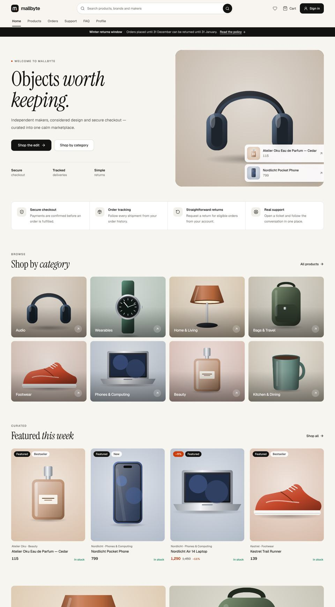

## Contents

- [Overview](#overview)
- [Key features](#key-features)
- [Tech stack](#tech-stack)
- [Architecture](#architecture)
- [UI and UX design](#ui-and-ux-design)
- [Screenshots](#screenshots)
- [Local setup](#local-setup)
- [Backend integration](#backend-integration)
- [Testing and quality checks](#testing-and-quality-checks)
- [Docker](#docker)
- [Project structure](#project-structure)
- [Security considerations](#security-considerations)
- [Current status and limitations](#current-status-and-limitations)

## Overview

A multi-vendor marketplace has three audiences with very different jobs: customers who browse, buy, return and ask for help; sellers who run a catalogue and fulfil their share of orders; and platform staff who moderate, ship, reconcile money and keep the system healthy. MallByte Web gives each audience its own workspace inside one application while the Django API remains the single source of truth for data, permissions and business rules.

The client is deliberately thin on business logic: it renders what the API returns, sends the user's intent back, and never decides on its own whether an action is allowed. Navigation chrome and route guards only hide what a role cannot use; the API enforces every permission.

## Key features

**Customers**
- Storefront home driven by published CMS content, catalogue with URL-synchronised search, filters, sorting and pagination, product detail with variants, reviews and related products.
- Cart, checkout with saved addresses, order history and order detail with shipment tracking, a simulated payment step, and recently viewed products and a wishlist.
- Return requests for delivered items (per-item quantity, reason and condition), return tracking and cancellation.
- Support center with tickets, threaded conversations and attachments; notification center with filters, bulk actions and channel/type preferences.
- Email one-time-code sign-in; seller applications.

**Sellers** (seller studio)
- Overview dashboard, sales analytics per currency and a ledger-based financial statement with payout eligibility.
- Product creation and editing (sectioned form with category/brand reference browsing), image and variant management.
- Seller order fulfilment (mark as processing), seller-scoped return visibility, store settings.

**Platform admins** (operations workspace)
- Control center, order management, return review (approve, reject, receive, refund), shipping (create shipments per eligible seller, lifecycle actions), inventory with stock adjustments, movement history and warehouse stock transfers.
- Seller application review and verification.
- Financial workspace: cash-flow analytics, reconciliation findings and seller ledger balances with CSV export, audit monitoring with manual audit runs.
- Content management for pages, banners, FAQs, announcements and navigation menus with draft/publish/archive and a private preview.
- Observability dashboard (health, latency, request/error/task logs, alerts, audit trail) and an incident & operations workbench.

**Super admins**
- Super Admin Console: platform overview with attention queues, user status management, role creation/assignment and permission editing, product moderation and the admin audit log.
- Privileged sign-in requires TOTP multi-factor authentication with one-time recovery codes.

Each permission-gated screen asks the API for the signed-in user's permissions (`/api/rbac/my-permissions/`) and fails closed when that check is unavailable.

## Tech stack

| Area | Technology |
| --- | --- |
| Framework | Next.js 16 (App Router, `output: "standalone"`), React 19, TypeScript 5 |
| Styling | Tailwind CSS 4 with design tokens in `src/app/globals.css`; self-hosted Geist, Geist Mono and Instrument Serif via `next/font/local` |
| State | Zustand (auth session, cart, notifications); component state for screen data |
| Data access | Axios client with bearer token, refresh-on-401 and session invalidation |
| Forms and validation | React Hook Form, Zod |
| Charts and icons | Recharts, lucide-react |
| Unit and component tests | Vitest 4, Testing Library, jsdom, axios-mock-adapter |
| Browser tests | Playwright (Chromium) against mocked API responses |
| Tooling | ESLint 9 (`eslint-config-next`), Prettier |

## Architecture

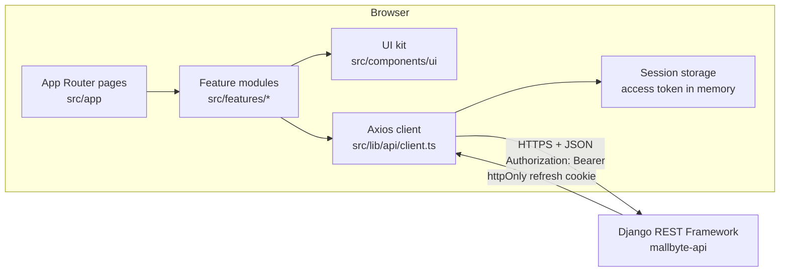

- **Routing.** Route groups separate audiences: `(customer)`, `(seller)`, `(admin)`, `(operations)` and `(auth)`, plus public storefront routes (`/`, `/products`, `/pages/[slug]`, `/faq`). Route pages are thin and render a feature component.
- **Frames.** `ShellFrame` picks the page frame from the route and the signed-in role: the storefront frame, the customer account frame (sidebar on desktop, horizontal rail on mobile) or `WorkspaceShell` with grouped navigation for seller and admin areas (`src/components/layout/workspace-nav.ts`).
- **Feature modules.** Each folder in `src/features` owns its API calls (`api.ts`), types, helpers and components, with tests next to them in `__tests__`.
- **Authorisation.** Route guards (`AdminOnlyRoute`, `SellerOnlyRoute`, `SuperAdminOnlyRoute`, `PlatformAnalyticsRoute`, `CmsRoute`, `ObservabilityRoute`) decide what to render; screens with finer permissions read `/api/rbac/my-permissions/` and default to read-only when the check fails.

### Authentication flow

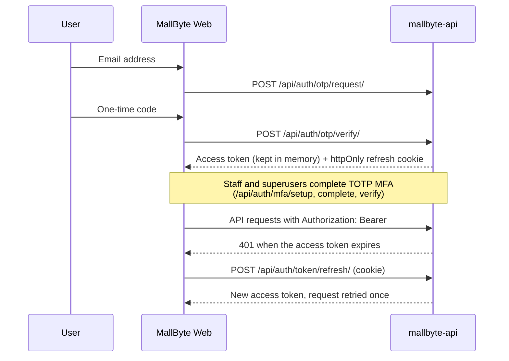

The access token is never written to storage. Only a logout marker is persisted in `localStorage` so other tabs end their session too, and a session generation counter discards responses that arrive after logout or an account switch.

## UI and UX design

The interface uses the **Ink & Ember** design system, documented in [docs/design-system.md](docs/design-system.md):

- **Tokens.** Warm paper surfaces, near-black ink for structure and primary actions, and one ember accent for brand moments and the active indicator. Legacy `slate`/`cyan` utilities are remapped to these scales in `globals.css`.
- **Typography.** Geist for interface text, Instrument Serif for editorial display moments (storefront titles, customer account headings), Geist Mono for order, shipment, return and ticket numbers. Tables and statistics use tabular figures.
- **Components.** `src/components/ui` provides buttons, form controls with a shared focus/invalid recipe, badges with lifecycle tones, cards and stat cards, page headers with breadcrumbs, skeletons, empty states and notices, pagination, description lists, framed tables, timelines, a segmented section switcher, an accessible dialog with focus trap and a confirmation dialog that can require a reason.
- **Layout patterns.** Detail screens use a main column plus a sticky summary/actions aside on large screens and a single column on phones. Lists use a filter toolbar and a framed table that scrolls inside its own container instead of the page.
- **States.** Loading uses content-shaped skeletons, empty states offer a next action, and errors appear inline with a retry action. Consequential operations (rejecting a product, suspending a user, cancelling a shipment, deciding a return, deleting content) confirm in a dialog.
- **Accessibility.** Visible focus outlines, a skip link, labelled controls, `aria-current` on navigation, `role="alert"`/`role="status"` for async results, 44px minimum touch targets on primary controls, reduced-motion support, and status meaning that never relies on colour alone.

## Screenshots

Captured from this repository's own application. The storefront and dashboard images ran against a local `mallbyte-api` with seeded demo data, and the product images are generated illustrations (see [docs/ui-evidence/redesign](docs/ui-evidence/redesign/README.md)). The deep-screen images are produced by the Playwright suite with mocked API data (see [docs/ui-evidence/phase4](docs/ui-evidence/phase4/README.md)).

| Storefront | Catalog (mobile) |
| --- | --- |
| 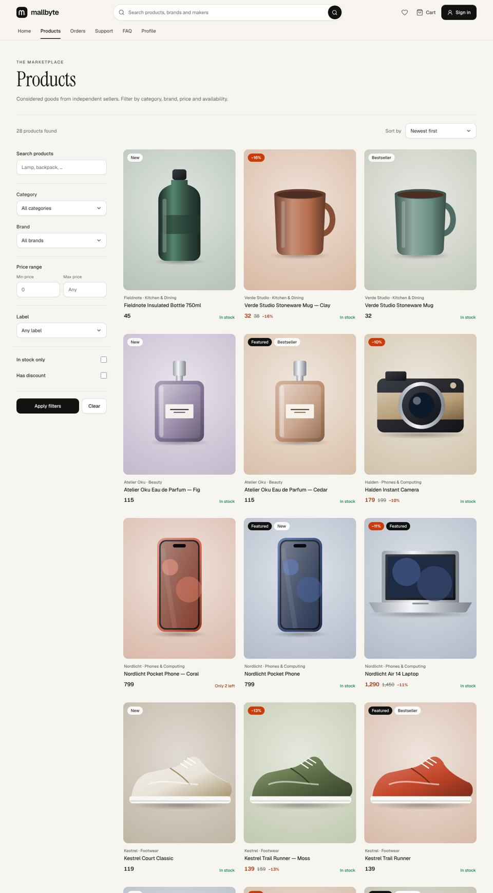 | 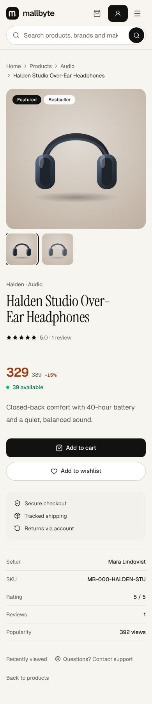 |

| Seller studio | Admin control center |
| --- | --- |
| 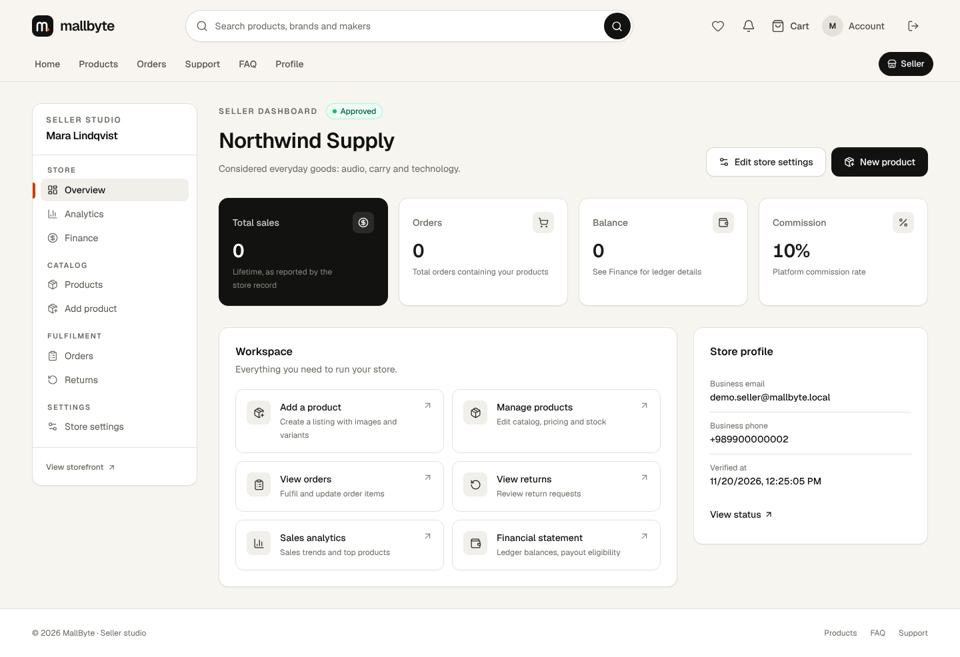 | 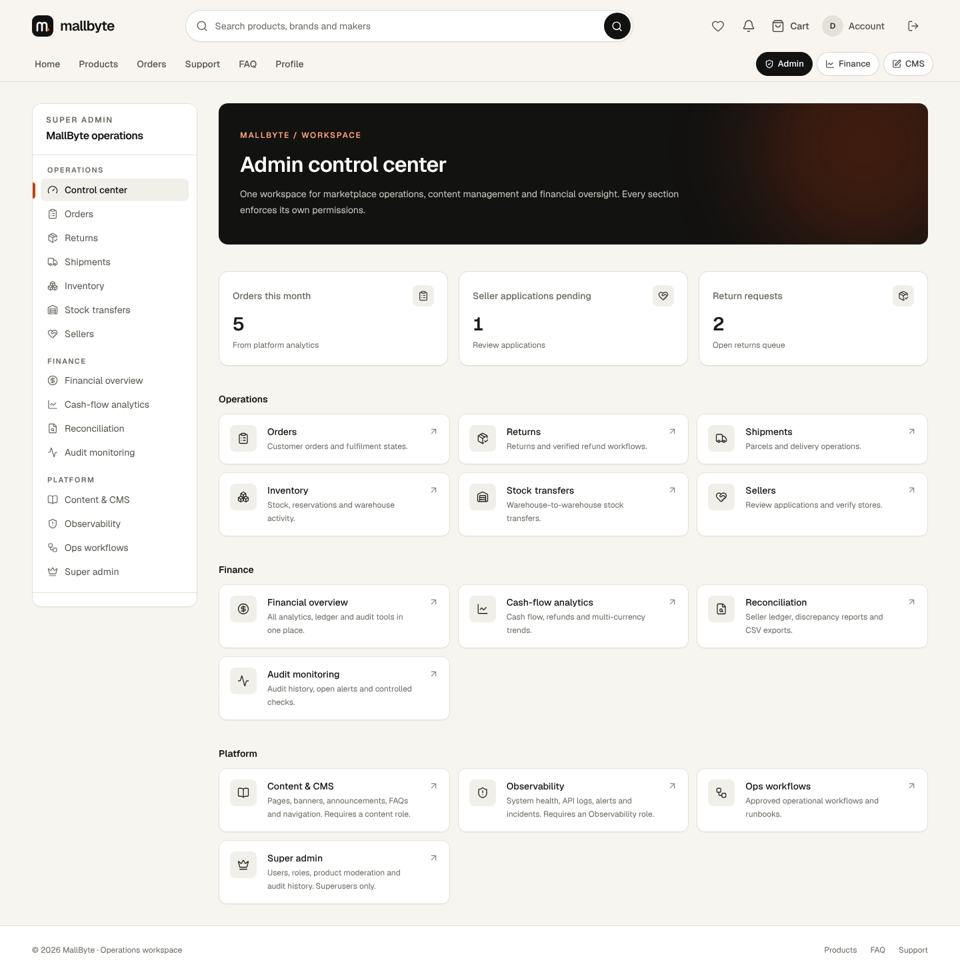 |

| Super Admin Console | Content management |
| --- | --- |
| 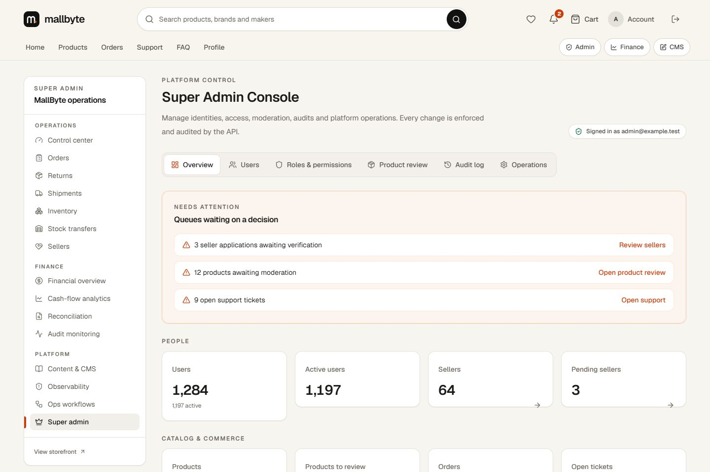 | 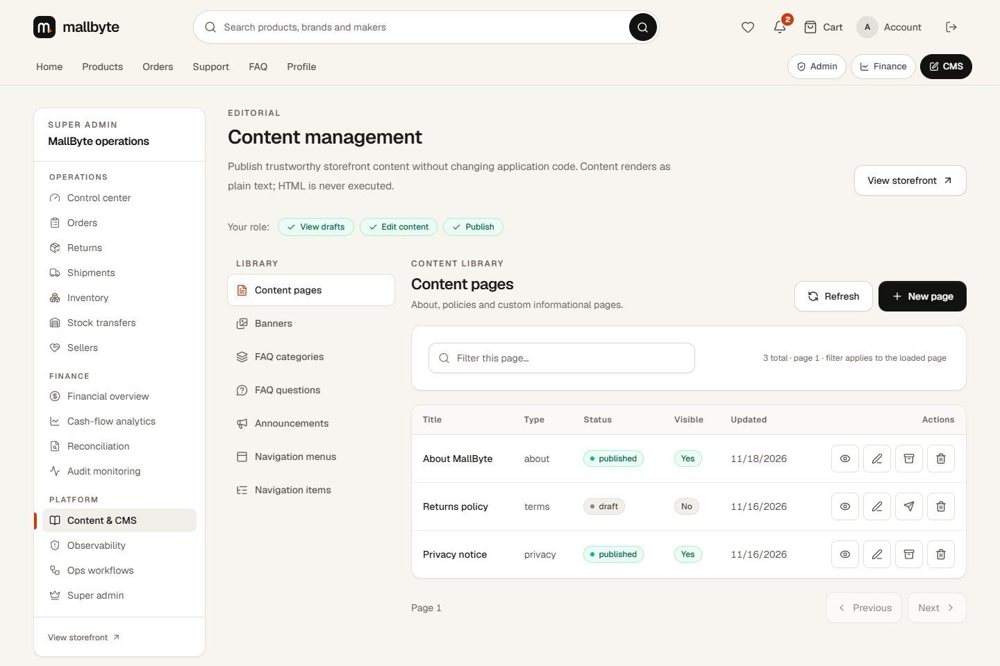 |

| Support conversation | Shipment detail (mobile) |
| --- | --- |
| 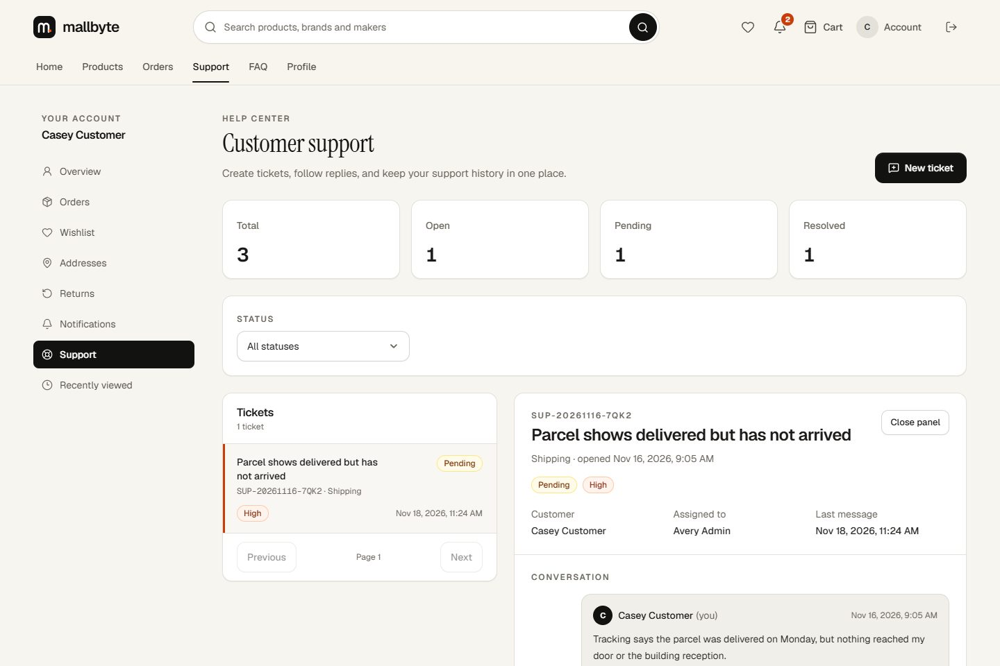 | 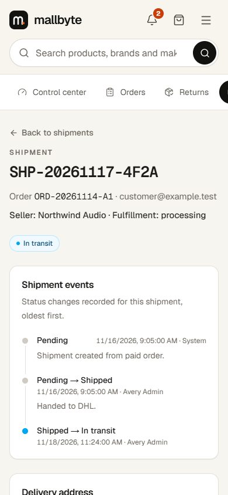 |

## Local setup

### Prerequisites

- Node.js 22 (the version used by CI and the Docker image) and npm.
- A running [mallbyte-api](https://github.com/sinamoghtaderfar/mallbyte-api) instance for real data. Without it, public pages render their error and empty states and sign-in is unavailable.

### Install and run

```bash
git clone https://github.com/sinamoghtaderfar/mallbyte-web.git
cd mallbyte-web
npm ci
cp .env.example .env.local
npm run dev
```

Open <http://localhost:3000>.

### Environment variables

| Variable | Default | Purpose |
| --- | --- | --- |
| `NEXT_PUBLIC_API_BASE_URL` | `http://localhost:8000` | Origin of the Django API. Inlined into the client bundle at build time, so it must never contain a secret. |

### Scripts

| Command | What it does |
| --- | --- |
| `npm run dev` | Next.js development server |
| `npm run build` | Production build (standalone output) |
| `npm run start` | Serve a production build |
| `npm run lint` | ESLint |
| `npm test` / `npm run test:run` | Vitest in watch mode / single run |

## Backend integration

The API lives in [sinamoghtaderfar/mallbyte-api](https://github.com/sinamoghtaderfar/mallbyte-api); follow its README to install, migrate and run it. For the web client to work against it:

1. Serve the API at the origin set in `NEXT_PUBLIC_API_BASE_URL` (default `http://localhost:8000`).
2. Allow the web origin (for example `http://localhost:3000`) in the API's CORS settings **with credentials**, because the refresh token travels in an httpOnly cookie and the client sends `withCredentials: true`.
3. Make sure the refresh cookie's `Secure`/`SameSite` settings match how you serve both apps (plain HTTP on localhost versus HTTPS across origins in staging).
4. Use an email backend that lets you read one-time codes in development, and enrol an authenticator app for staff accounts, which must pass MFA.

All endpoint paths the client uses are collected in [`src/lib/api/endpoints.ts`](src/lib/api/endpoints.ts) and in each feature's `api.ts`.

## Testing and quality checks

```bash
npm run test:run          # Vitest unit and component tests
npx tsc --noEmit          # TypeScript type check
npm run lint              # ESLint
npm run build             # Production build
```

On Node.js 25 or newer, the built-in Web Storage API shadows jsdom's `localStorage` and the auth/session tests fail. Run Vitest with `NODE_OPTIONS=--no-experimental-webstorage` there, or use Node.js 22 as CI does.

### Browser tests (Playwright)

The Playwright suite runs Chromium against a real Next.js dev server with **mocked** API responses. Unrecognised API calls fail closed, so tests never touch a live backend. It covers catalogue deep links and history, MFA enrolment and recovery-code sign-in, session expiry, dialog keyboard behaviour, form contrast, shared navigation, and the operational deep screens at 390, 834 and 1440 pixels wide with a check that the page never scrolls horizontally.

```bash
mkdir -p .playwright-runner
npm install --prefix .playwright-runner --no-save @playwright/test@1.58.2
ln -s ../.playwright-runner/node_modules/@playwright node_modules/@playwright
.playwright-runner/node_modules/.bin/playwright install chromium
.playwright-runner/node_modules/.bin/playwright test
```

Set `CAPTURE_UI_EVIDENCE=1` to also write the deep-screen screenshots to `docs/ui-evidence/phase4/`. See [docs/PLAYWRIGHT_E2E.md](docs/PLAYWRIGHT_E2E.md) for what these tests do and do not prove.

### Continuous integration

- `frontend-ci.yml` runs Vitest, ESLint and the production build on pushes and pull requests to `main`.
- `browser-e2e.yml` runs the Playwright suite on pushes and pull requests to `main`.
- `frontend-image-ci.yml` builds the non-root production image as a smoke check.

## Docker

`Dockerfile.production` is a multi-stage build (Node 22 Alpine) that produces a non-root image containing only the Next.js standalone server, static assets and `public/`. Because `NEXT_PUBLIC_API_BASE_URL` is compiled into the bundle, the build fails unless you pass it, and each API origin needs its own image.

```bash
docker build -f Dockerfile.production \
  --build-arg NEXT_PUBLIC_API_BASE_URL=https://staging-api.example.com \
  -t mallbyte-web:staging .
```

`compose.staging.yaml` runs that image bound to `127.0.0.1:3000` with all capabilities dropped, `no-new-privileges`, a tmpfs `/tmp` and an HTTP health check. Put a trusted HTTPS reverse proxy in front of it. Read [docs/FRONTEND_PRODUCTION.md](docs/FRONTEND_PRODUCTION.md) for the release checklist.

## Project structure

```text
src/
  app/                      App Router routes, root layout, fonts and globals.css (design tokens)
    (customer)/             Account area: orders, returns, wishlist, addresses, notifications, support, seller onboarding
    (seller)/               Seller fulfilment: orders and returns
    (admin)/admin/          Operations workspace, finance, CMS, observability, super admin
    (operations)/           Warehouse stock transfers
    products/, pages/, faq/ Public storefront routes
  components/
    layout/                 Site header and shell, account navigation, workspace shell and navigation map
    ui/                     Design-system components
  features/<domain>/        api.ts, types.ts, helpers, components/ and __tests__/ per domain
                            (auth, products, cart, orders, payments, returns, shipments, inventory,
                             seller-*, settlements, insights, content, support, notifications,
                             observability*, super-admin, rbac, ...)
  lib/
    api/                    Axios client, endpoint map, error normalisation
    auth/                   In-memory session and cross-tab logout marker
    media/                  Image URL normalisation
  types/                    Shared API types (pagination)
e2e/                        Playwright specs and API mock helpers
docs/                       Design system, production and E2E notes, UI evidence
```

## Security considerations

- **Tokens.** The access token lives only in memory; the refresh token is an httpOnly cookie set by the API. No credential or user record is written to browser storage.
- **Authorisation.** The client hides what a role cannot use, but the API enforces every permission. Permission checks fail closed, and privileged accounts cannot be changed from the Super Admin Console.
- **Sessions.** Logout in one tab ends the session in all tabs, refresh is retried once, and responses that arrive after logout or an account switch are discarded.
- **Content.** CMS content is rendered as text and never as HTML. CMS links are restricted to internal paths or http(s) URLs, and image URLs are normalised before use.
- **Secrets and configuration.** Only `NEXT_PUBLIC_API_BASE_URL` is read, and it is public by design. `.env*` files other than `.env.example` are git-ignored and excluded from the Docker build context. Never put a secret in a `NEXT_PUBLIC_*` variable.
- **Tests.** Browser tests use mocked API responses with `example.test` identities and fail closed on unknown requests.

## Current status and limitations

**Implemented and verified on the `design/premium-redesign` branch**
- Customer, seller, admin and super-admin screens listed above, including the Ink & Ember redesign of the storefront, the workspaces and the operational deep screens.
- Vitest unit and component tests, TypeScript, ESLint, the production build and the Playwright suite with mocked API responses all pass locally.

**Not verified by this repository**
- End-to-end behaviour against a live API (OTP email delivery, payment provider settlement, Celery tasks, bank reconciliation). The Playwright suite exercises only the browser contract.
- A formal WCAG audit or cross-browser testing beyond Chromium.
- Any deployment. No hosted environment is described or implied here.

**Known limitations**
- Catalogue and order amounts are shown without a currency because those endpoints do not return one. Finance screens show currencies only where the API provides them.
- Some list filters (orders, returns, seller returns) apply to the loaded page only, because the corresponding endpoints paginate but do not filter on the server. The screens say so.
- A few legacy confirmations (deleting seller products, images and variants, and acknowledging or resolving observability alerts) still use the browser's native confirm dialog.
- The payment step is a simulator for development.
